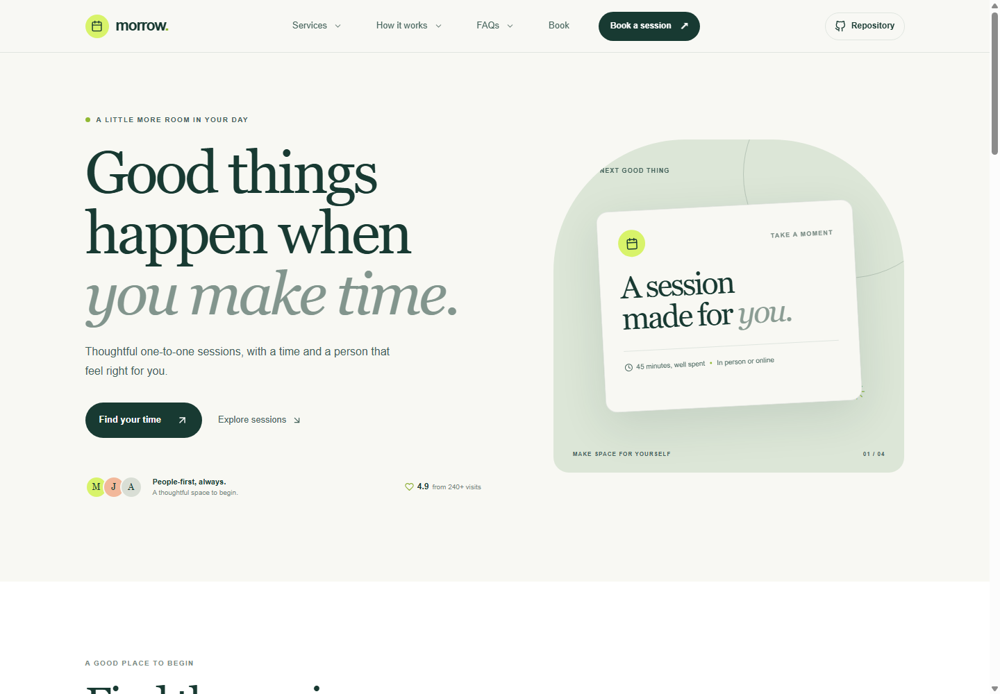

# Morrow | Appointment Booking

Morrow is a responsive appointment request page for browsing services, choosing an available time, and reviewing booking details before confirming.

**Live site:** [https://a2rp.github.io/appointment-booking/](https://a2rp.github.io/appointment-booking/)

## What you can do

- Browse services and compare session details.
- Choose a date and an available time from the booking flow.
- Enter contact details and review the selected service and time.
- Submit the request and see a confirmation view.
- Return to the page later; confirmed requests are saved in this browser.
- Use section links, the service menu, and the back-to-top control on desktop or mobile.

## Booking data

This is a front-end demo. Booking requests are stored in the browser local storage when it is available. The app does not contact a business, send email, or reserve a real appointment. Clearing this browser data removes the saved requests.

## Run locally

Install dependencies with npm install, then start the Vite server with npm run dev.

Run npm run lint to check the code and npm run build to create a production build.

## Deploy

Run npm run deploy to build the app and publish the dist folder to the gh-pages branch.

## Future improvements

These are ideas for future work and are not implemented:

- Connect the form to a real scheduling service.
- Add email confirmations and rescheduling links.
- Add staff availability and appointment durations.

## Links

- Portfolio: [https://www.ashishranjan.net](https://www.ashishranjan.net)
- GitHub: [https://github.com/a2rp](https://github.com/a2rp)
- CodePen: [https://codepen.io/ash1198](https://codepen.io/ash1198)
- LinkedIn: [https://www.linkedin.com/in/aashishranjan](https://www.linkedin.com/in/aashishranjan)
- Facebook: [https://www.facebook.com/theash.ashish/](https://www.facebook.com/theash.ashish/)
- YouTube: [https://www.youtube.com/@ashishranjan-ashz?sub_confirmation=1](https://www.youtube.com/@ashishranjan-ashz?sub_confirmation=1)
- Email: [mailto:ash.ranjan09@gmail.com](mailto:ash.ranjan09@gmail.com)

## Support

- Support: [https://a2rp-donation-page.netlify.app/](https://a2rp-donation-page.netlify.app/)
- Buy Me a Coffee: [https://buymeacoffee.com/ashishranjan](https://buymeacoffee.com/ashishranjan)
- Patreon: [https://www.patreon.com/ashishranjan](https://www.patreon.com/ashishranjan)
